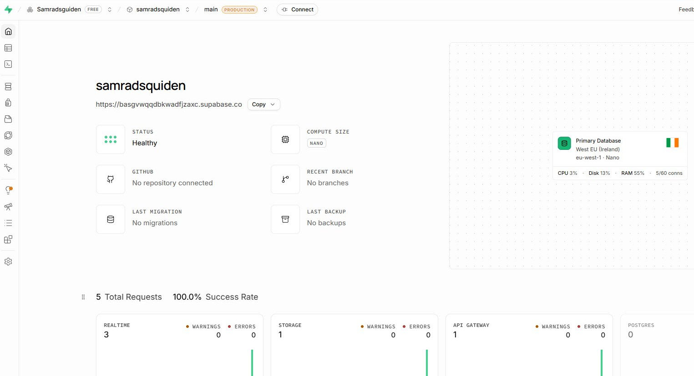
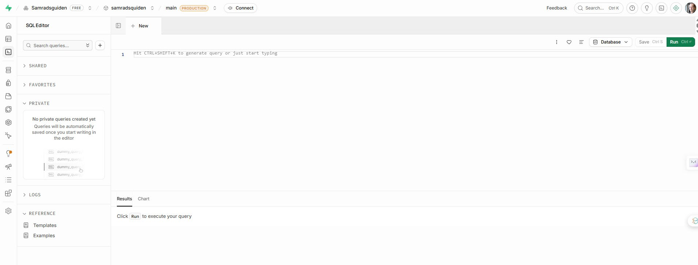
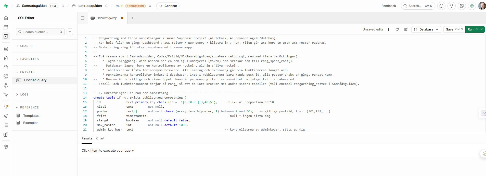
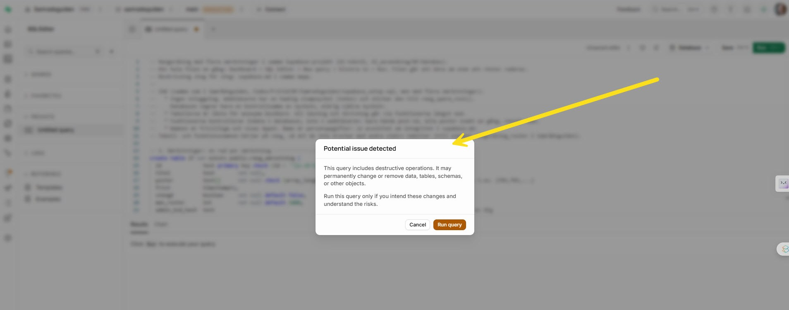
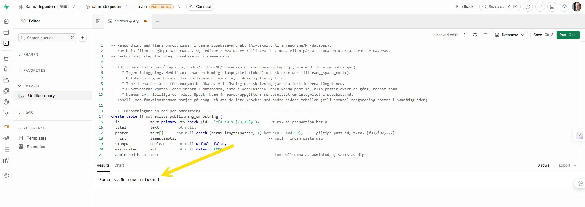
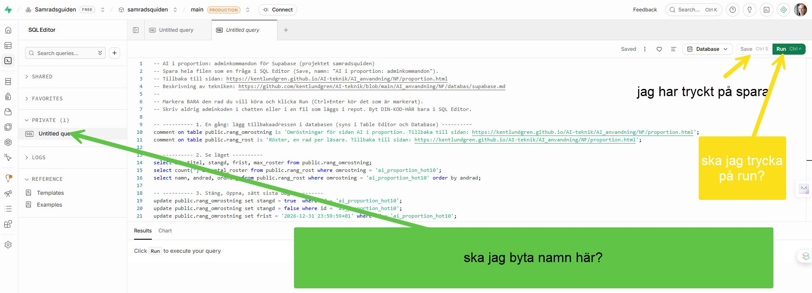
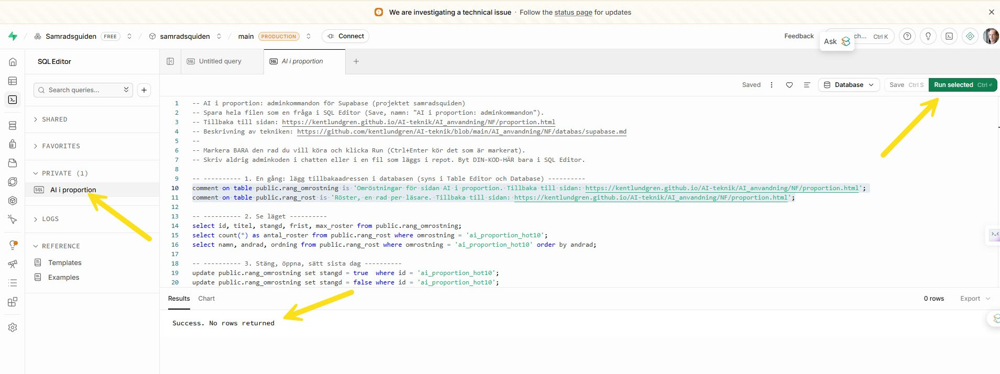
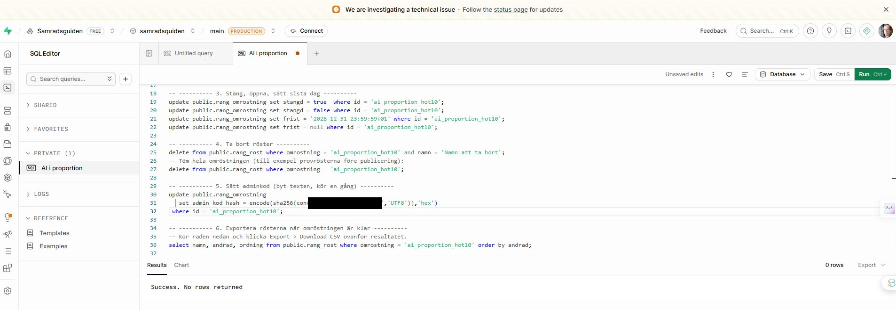

# Så kopplades rangordningen till Supabase: steg för steg med bilder

**Version:** 1.0 · **Datum:** 2026-11-12 · **Avsändare:** Kent Lundgren
**Status:** berättelse om hur uppkopplingen gick till, med skärmdumpar. Tekniken och reglerna står i [supabase.md](https://github.com/kentlundgren/AI-teknik/blob/main/AI_anvandning/NF/databas/supabase.md). Sidan som använder databasen är [AI i proportion](https://kentlundgren.github.io/AI-teknik/AI_anvandning/NF/proportion.html).

## Kort version 

Rangordningen på sidan AI i proportion sparar läsarnas röster i en Supabase-databas (en molntjänst med en Postgres-databas, se [Ordlista](#ordlista)). Jag använde det Supabase-projekt som redan fanns för Samrådsguiden, `samradsquiden`, i stället för att skapa ett nytt. Det var pausat och väcktes med **Resume project**. Sedan klistrade jag in en SQL-fil i SQL Editor och körde den, sparade adminkommandona som en egen fråga och satte en adminkod. Därefter kontrollerades att databasen svarade och att tabellerna var låsta.

Bilderna är skärmdumpar från min webbläsare. Jag har beskurit bort webbläsarens bokmärkesfält, och adminkoden är övertäckt i Bild 8.

## Förutsättningar 

- **Projektet:** `samradsquiden` i organisationen `Samradsguiden`, gratisplanen (Free), regionen West EU (Ireland), `eu-west-1`.
- **Varför samma projekt:** varje omröstning är en rad i tabellen `rang_omrostning`, och funktionerna tar omröstningens id, så flera omröstningar kan dela projekt utan att blandas ihop. Resonemanget står i [supabase.md, avsnitt 2b](https://github.com/kentlundgren/AI-teknik/blob/main/AI_anvandning/NF/databas/supabase.md).
- **SQL-filen:** [supabase_rangordning.sql](https://github.com/kentlundgren/AI-teknik/blob/main/AI_anvandning/NF/databas/supabase_rangordning.sql) skapar två tabeller, slår på Row Level Security (radskydd, se [Ordlista](#ordlista)) och lägger till fem funktioner. Den lägger också in omröstningen `ai_proportion_hot10` med tio poster. Alla namn börjar på `rang_`, så Samrådsguidens egna tabeller berörs inte.

## Steg 1. Väck projektet 

Gratisprojekt pausas efter en vecka utan användning. Samrådsguidens omröstning stängdes 2026-11-06, och när jag öppnade projektet var det pausat: dashboarden visade *Project is paused*, och projektets adress gick inte att slå upp. Dialogen erbjöd **Resume project**, som väcker projektet, och **Restore** hör till säkerhetskopior, vilket är en annan sak. Dashboarden visade också att datan, även säkerhetskopior, är säker och att projektet går att väcka till och med 7 december 2027. Jag klickade på Resume project och väntade tills Status blev **Healthy**.

*Bild 1. Projektets översikt efter att det väckts: Status Healthy, regionen West EU (Ireland), gratisplanen och projektets adress.*

## Steg 2. Öppna SQL Editor 

I vänstermenyn finns **SQL Editor**. Där öppnade jag en ny, tom fråga. SQL Editor är ett fönster i dashboarden där man skriver och kör SQL direkt mot projektets databas.

*Bild 2. Ett tomt SQL-fönster, redo att fyllas.*

## Steg 3. Klistra in SQL-filen 

Jag öppnade `supabase_rangordning.sql` på min dator, kopierade hela innehållet och klistrade in det i fönstret. De första raderna är kommentarer som säger vad filen gör: ingen inloggning för läsarna, låsta tabeller, funktioner som kontrollerar all indata och frivilliga namn.

*Bild 3. Hela SQL-filen inklistrad i SQL Editor, med de första tabelldefinitionerna synliga.*

## Steg 4. Kör filen och bekräfta varningen 

När jag klickade **Run** visade Supabase rutan *Potential issue detected*: frågan innehåller operationer som kan ändra eller ta bort data. Varningen utlöses av ord som `revoke` och `delete` i filen. Jag hade läst igenom var de förekommer. De slår på radskyddet, begränsar vem som får köra funktionerna, och ligger i funktioner som bara körs när någon röstar eller nollställer. Filen har inget `drop` och inget `truncate`. Jag klickade **Run query**.

*Bild 4. Supabases varning "Potential issue detected" innan frågan körs.*

## Steg 5. Kontrollera resultatet 

Under fönstret, fliken **Results**, stod *Success. No rows returned*. Det betyder att alla satser gick igenom. Filen går att köra om utan att några röster raderas.

*Bild 5. Resultatet: "Success. No rows returned".*

## Steg 6. Kontrollera utifrån 

Med projektets publika nyckel (den som sidan själv använder, `sb_publishable_…`) anropades funktionerna utifrån, för att se att de svarade och att tabellerna var låsta:

- `rang_hamta_status` för `ai_proportion_hot10` svarade `antal: 0`, `stangd: false` och ingen sista dag.
- `rang_hamta_roster` svarade med en tom lista.
- Ett direkt anrop mot tabellen `rang_rost` nekades med *permission denied* (HTTP 401). Ingen kan alltså läsa eller skriva direkt i tabellerna, bara via funktionerna.

Före steg 5 hade samma anrop svarat att funktionen inte fanns, vilket visade att projektet var vaket men att SQL-filen ännu inte var körd.

## Steg 7. Spara adminkommandona som en egen fråga 

Filen [supabase_admin.sql](https://github.com/kentlundgren/AI-teknik/blob/main/AI_anvandning/NF/databas/supabase_admin.sql) samlar kommandon för att se läget, stänga eller öppna omröstningen, sätta sista dag, ta bort röster, sätta adminkod och exportera rösterna. Jag klistrade in den i en ny fråga, sparade med **Save** och döpte frågan till "AI i proportion". Den ligger sedan under **Private** i vänstermenyn. Första raderna har sidans adress, så det går att hitta tillbaka dit.

*Bild 6. Adminkommandona sparade som frågan "AI i proportion" (Saved, under Private).*

## Steg 8. Lägg tillbakaadressen i databasen 

Supabase har inget fält för en klickbar länk, så adressen till sidan lades som en kommentar på tabellerna med `comment on table`. Jag markerade de två raderna och klickade **Run selected**. Bara det markerade körs. Kör man utan att markera körs hela filen, inklusive `delete`.

*Bild 7. De två `comment on table`-raderna markerade och körda: "Success. No rows returned".*

## Steg 9. Sätt en adminkod 

Med adminkoden kan jag nollställa rösterna från sidan. Databasen sparar bara en kontrollsumma (en sha256-hash) av koden, aldrig koden själv. Jag bytte texten `DIN-KOD-HÄR` i fråga 5 mot min kod, markerade de tre raderna och körde dem. Koden visas inte i bilden: den är övertäckt, och själva koden ligger inte i något dokument i repot.

*Bild 8. Rubrik 5 i adminfrågan, där koden sätts. Texten mellan citattecknen är övertäckt.*

## Steg 10. Prov med en röst 

På sidan flyttade jag raderna i rangordningen och skrev ett provnamn. Därefter svarade `rang_hamta_status` `antal: 1`, och `rang_hamta_roster` gav en röst med alla tio frågorna (f01 till f10) exakt en gång. Det visar att hela vägen fungerar: sidan, funktionen och tabellen. Provrösten ligger kvar tills jag raderar den med raden under rubrik 4 i adminfrågan.

## Vad som inte visas på bilderna 

- Skapandet av Supabase-kontot, organisationen och projektet `samradsquiden`. De gjordes för Samrådsguiden. Stegen finns i [Samrådsguidens supabase.md](https://github.com/kentlundgren/Codex/blob/main/Fritid/NF/Samradsguiden/supabase.md).
- Dialogen med **Resume project** i steg 1.
- Adminkoden. Den ska inte synas i något dokument.

## Genvägar mellan sidan och Supabase 

Sidan AI i proportion har en liten adminrad med länkar till projektet, SQL Editor och adminkommandona. Länkarna kräver inloggning och ger ingen åtkomst. Mer om det: [supabase.md, avsnitt 5b](https://github.com/kentlundgren/AI-teknik/blob/main/AI_anvandning/NF/databas/supabase.md).

## Ordlista 

- **Supabase:** en molntjänst som ger varje projekt en egen Postgres-databas och ett API.
- **Postgres:** en databasmotor. SQL är språket man ställer frågor och ger kommandon med.
- **SQL Editor:** fönstret i Supabases dashboard där SQL skrivs och körs.
- **Row Level Security (RLS, radskydd):** en spärr i databasen som avgör vem som får se och ändra vilka rader. Utan den kan en tabell i ett öppet schema läsas och skrivas av vem som helst.
- **Publik nyckel (`sb_publishable_…`):** projektets nyckel för webbsidor. Den är avsedd att ligga öppet i sidan, eftersom skyddet sitter i databasen och inte i nyckeln. En hemlig nyckel (`secret`, `service_role`) får aldrig ligga i en sida eller ett repo.
- **Funktion (RPC):** ett förprogrammerat anrop som sidan får göra, till exempel `rang_spara_rost`. Funktionen kontrollerar indatan i databasen.
- **Hash (kontrollsumma):** ett avtryck av en text som inte går att vända tillbaka. Databasen sparar avtrycket av adminkoden, inte koden.

## Källor 

- Supabase (u.å.) *Billing FAQ*. Tillgänglig på: <https://supabase.com/docs/guides/platform/billing-faq> (Hämtad: 12 november 2026). *(Pausade gratisprojekt kostar inget och räknas inte mot de två gratisprojekten.)*
- Supabase (u.å.) *Pricing & Fees*. Tillgänglig på: <https://supabase.com/pricing> (Hämtad: 12 november 2026). *(Gratisnivåns gränser och pausen efter en veckas inaktivitet.)*
- Supabase (u.å.) *Row Level Security*. Tillgänglig på: <https://supabase.com/docs/guides/database/postgres/row-level-security> (Hämtad: 12 november 2026). *(Varför radskyddet ska vara på.)*

Skärmdumparna och uppgifterna om projektet är från min egen dashboard 2026-11-12. Kontrollera mot Supabases dokumentation innan något återges, eftersom tjänstens gränser och knappar kan ändras.

**Tillbaka till sidan:** [AI i proportion](https://kentlundgren.github.io/AI-teknik/AI_anvandning/NF/proportion.html#rangordna), där rangordningen och länken till det här dokumentet finns.

## Repo

- GitHub: https://github.com/kentlundgren/AI-teknik/tree/main/AI_anvandning/NF/databas
- Lokal sökväg: `C:\Users\kentl\OneDrive\AI\AI-teknik\AI_anvandning\NF\databas`
